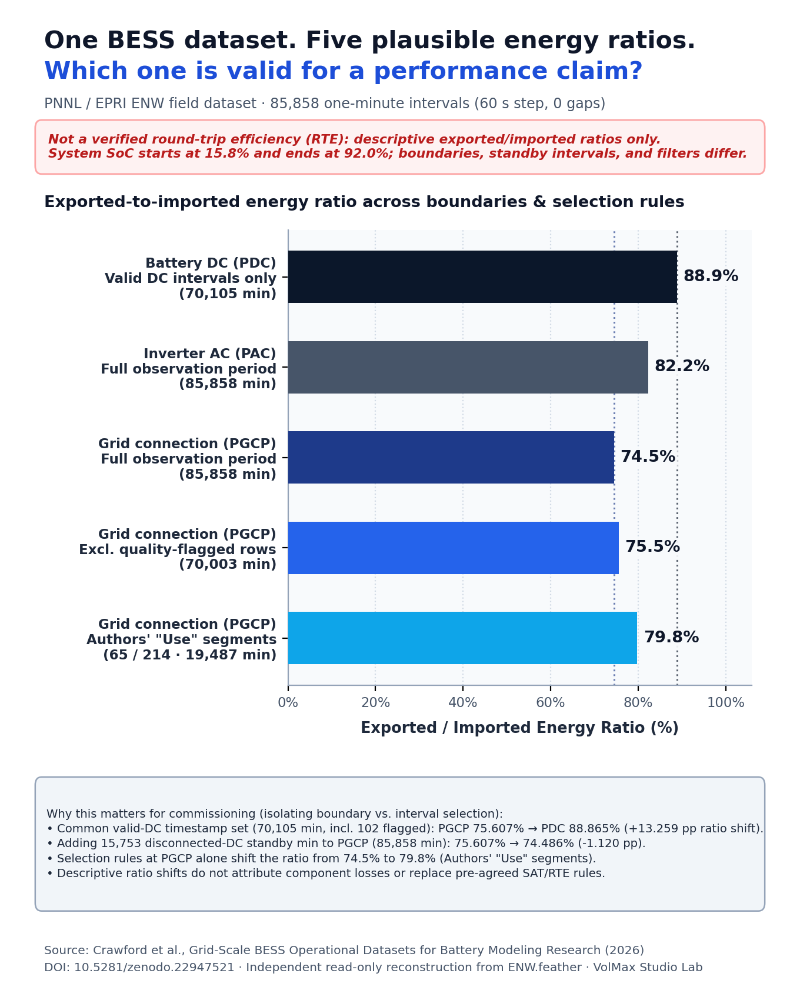

# BESS Field Evidence — VolMax Studio Lab

**Independent reconstruction of BESS performance-related calculations from real operating data.**

## Case 01 — One dataset, five energy ratios

Using the published PNNL/EPRI **ENW** field dataset, we calculated the ratio of exported to imported energy under five measurement-boundary and interval-selection choices.



| Measurement boundary and selection | Intervals | Exported / imported |
|---|---:|---:|
| Battery DC (PDC), non-null DC measurements | 70,105 | **88.9%** |
| Inverter AC (PAC), full observation period | 85,858 | **82.2%** |
| Grid connection (PGCP), full observation period | 85,858 | **74.5%** |
| Grid connection (PGCP), excluding any quality-flagged timestamp | 70,003 | **75.5%** |
| Grid connection (PGCP), authors' `Use` segments | 19,487 | **79.8%** |

The authors' published workflow supplies `QualityFlag`, `CycleIndex` and `Use`; we use those fields rather than inventing an acceptance rule.

**Engineering point:** the measurement boundary and selection of operating intervals change the reported value. They must be defined before a performance claim can be evaluated.

**Important:** These are *descriptive exported-to-imported ratios*, **not verified round-trip efficiency (RTE)**. The published system SoC changes from **15.8% to 92.0%** over the observation period, and the selected windows differ. This work does **not** constitute a FAT/SAT acceptance verdict or claim an error in the original research.

[Open the full ENW methods and findings](./enw-pnnl-epri/README.md)

## Reproduce the results

From the repository root, with Python 3.12 or a compatible version:

```bash
python -m venv .venv
source .venv/bin/activate
pip install -r requirements.txt
python enw-pnnl-epri/reproduce.py
```

The script **downloads the original 6.9 MB `ENW.feather` dataset from Zenodo**, verifies its MD5 and SHA-256 checksums against the [source manifest](./enw-pnnl-epri/source_manifest.json), and calculates all five ratios. The original dataset is hosted by its publishers; the program and chart are in this repository.

## Data provenance and licenses

- **Original publication:** *Grid-Scale BESS Operational Datasets for Battery Modeling Research* (PNNL/EPRI, 2026).
- **Source dataset:** [Zenodo DOI 10.5281/zenodo.22947521](https://doi.org/10.5281/zenodo.22947521), **CC BY 4.0**.
- **VolMax reconstruction code:** [MIT License](./LICENSE).
- **Method:** transparent, retrospective reconstruction of published measurements; not an independently commissioned acceptance test.
