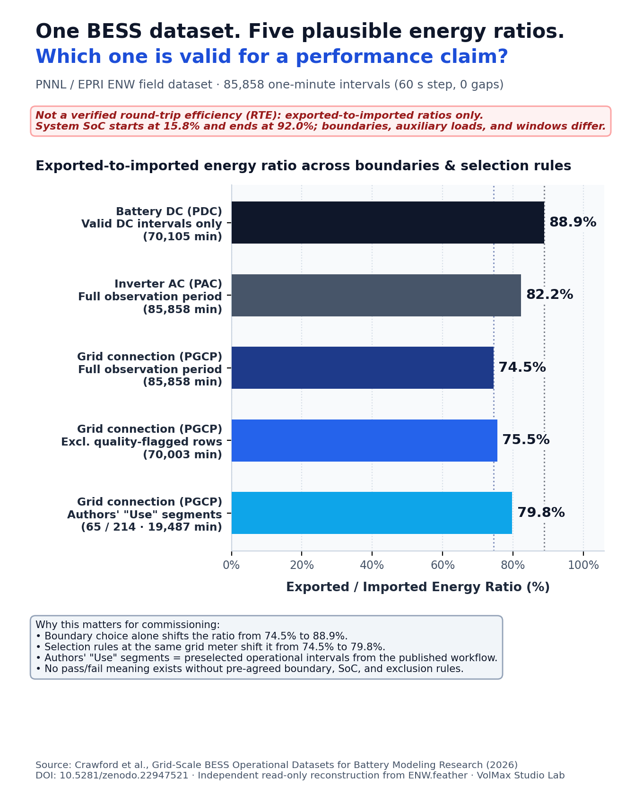

# PNNL / EPRI ENW — Five Energy Ratios from One BESS Dataset



## What this proves

Using the published 1-minute field dataset from the **PNNL / EPRI Grid-Scale BESS Operational Datasets** (`ENW`, 85,858 timestamps per meter at exact 60.0 s spacing, zero missing timestamps), integrating positive (exported/discharged) versus negative (imported/charged) normalized power gives **five different exported-to-imported energy ratios** depending solely on measurement boundary and interval-selection rules:

| Measurement Boundary & Selection Rule | Valid Intervals | Exported / Imported Ratio |
|---|---:|---:|
| **Battery DC (`PDC`)** — valid DC intervals only (`Power` non-null) | 70,105 min | **88.9%** (`88.87%`) |
| **Inverter AC (`PAC`)** — full observation period | 85,858 min | **82.2%** (`82.25%`) |
| **Grid connection (`PGCP`)** — full observation period | 85,858 min | **74.5%** (`74.49%`) |
| **Grid connection (`PGCP`)** — excluding quality-flagged rows | 70,003 min | **75.5%** (`75.54%`) |
| **Grid connection (`PGCP`)** — authors' `Use` segments (65 / 214) | 19,487 min | **79.8%** (`79.78%`) |

## Epistemic boundaries & limitations

1. **Not verified RTE values:** None of the five ratios is a verified contractual round-trip efficiency (RTE) metric. Over the full `ENW` series, system `SOC` rises from **`15.8%`** (`0.158`) at the start to **`92.0%`** (`0.920`) at the end, meaning net stored energy changes across the window.
2. **Not SAT pass/fail verdicts:** A performance ratio cannot be judged compliant or non-compliant without pre-agreed contract terms specifying meter boundary, auxiliary load treatment, `SOC` closure, and data-exclusion rules.
3. **Normalized units:** Per the official dataset documentation, power values in `ENW.feather` are normalized to C-rate and timestamps are expressed as `HoursElapsed` (no physical kWh or calendar timestamps are published).
4. **Transparent post-hoc analysis:** This is an independent, read-only reconstruction of published field data rather than a pre-registered commissioning test.
5. **Quality-flagging detail:** In the published R workflow (`ENW.R` + `_common.R`), `15,851` timestamps are flagged across all four meters (`15,753` disconnected DC intervals + `98` averaged duplicate timestamps), while `_common.R` adds `4` idle `SOC_JUMP` flags on `PDC` only (`15,855` any-meter flagged timestamps). Excluding either `~any_quality_flag` (`70,003` min, `75.5420%`) or `~pgcp_quality_flag` (`70,007` min, `75.5415%`) yields **`75.5%`**. Separately, `Use == True` reflects the authors' published modeling-segment selection rule (`65` of `214` `CycleIndex` segments), not a universal acceptance standard.

## Reproduce from scratch

From the repository root (or inside `enw-pnnl-epri/`):

```bash
python -m venv .venv
source .venv/bin/activate
pip install -r requirements.txt
python enw-pnnl-epri/reproduce.py
```

The script automatically downloads `ENW.feather` (`6.9 MB`) from the official Zenodo API URL recorded in [`source_manifest.json`](./source_manifest.json), verifies both `MD5` and `SHA-256` checksums, checks uniform 60.0 s spacing, and prints all five ratios along with the scope disclaimers.

## Source & Attribution

- **Dataset:** Alasdair Crawford and Joe Thompson (2026), *Grid-Scale BESS Operational Datasets for Battery Modeling Research*, Pacific Northwest National Laboratory (PNNL) & Electric Power Research Institute (EPRI), Zenodo.
- **DOI:** [`10.5281/zenodo.22947521`](https://doi.org/10.5281/zenodo.22947521)
- **License:** [CC BY 4.0](https://creativecommons.org/licenses/by/4.0/)
- Source files are **not** redistributed in this repository; `reproduce.py` fetches `ENW.feather` directly from Zenodo (`https://zenodo.org/api/records/22947521/files/ENW.feather/content`).
